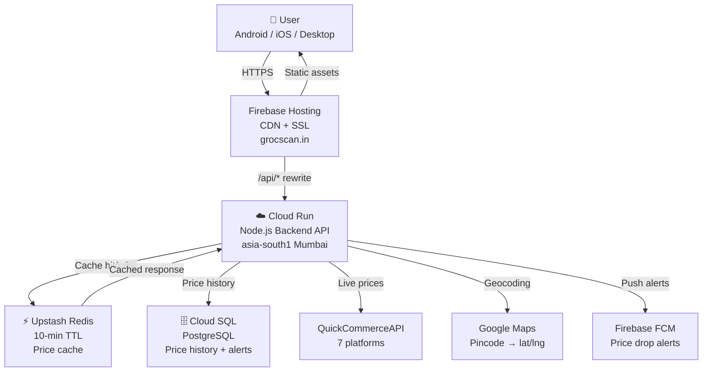
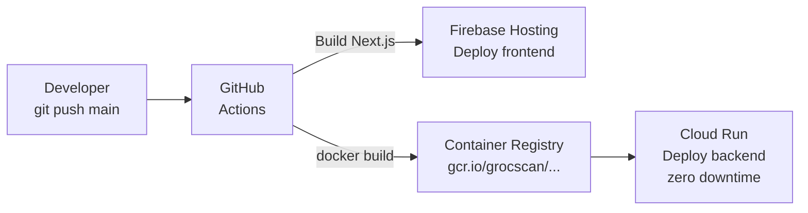

# 🏗️ GrocScan — Application & Deployment Architecture

> **Document**: Architecture Reference  
> **Version**: 1.0 | July 2026  
> **Status**: Pre-build review — please approve before coding begins

---

## 📋 Table of Contents
1. [Big Picture Overview](#1-big-picture-overview)
2. [Application Architecture](#2-application-architecture)
3. [Frontend Architecture](#3-frontend-architecture)
4. [Backend Architecture](#4-backend-architecture)
5. [Data Architecture](#5-data-architecture)
6. [Data Flow Diagrams](#6-data-flow-diagrams)
7. [Deployment Architecture (GCP)](#7-deployment-architecture-gcp)
8. [CI/CD Pipeline](#8-cicd-pipeline)
9. [Environments](#9-environments)
10. [Network & Security](#10-network--security)
11. [Architecture Decisions](#11-architecture-decisions)

---

## 1. Big Picture Overview

```
╔══════════════════════════════════════════════════════════════════╗
║                        GROCSCAN SYSTEM                           ║
║                                                                   ║
║  ┌──────────────┐     ┌──────────────┐     ┌──────────────────┐  ║
║  │   FRONTEND   │────▶│   BACKEND    │────▶│  EXTERNAL APIs   │  ║
║  │  (Next.js)   │◀────│  (Node.js)   │◀────│ QuickCommerceAPI │  ║
║  │  Firebase    │     │  Cloud Run   │     │ Google Maps      │  ║
║  │  Hosting     │     │  Mumbai      │     │ Firebase FCM     │  ║
║  └──────────────┘     └──────┬───────┘     └──────────────────┘  ║
║                              │                                    ║
║                    ┌─────────┴────────┐                          ║
║                    │                  │                           ║
║             ┌──────▼──────┐   ┌──────▼──────┐                   ║
║             │  Upstash    │   │  Cloud SQL  │                    ║
║             │  Redis      │   │  PostgreSQL │                    ║
║             │  (Cache)    │   │  (History)  │                    ║
║             └─────────────┘   └─────────────┘                    ║
╚══════════════════════════════════════════════════════════════════╝
```

### Layer Responsibilities

| Layer | Technology | Responsibility |
|---|---|---|
| **Frontend** | Next.js 14 (PWA) | UI, routing, state management |
| **Backend API** | Node.js + Express on Cloud Run | Business logic, caching, aggregation |
| **Cache** | Upstash Redis | Price data cache (10-min TTL) |
| **Database** | Cloud SQL PostgreSQL | Price history, pincodes, alerts |
| **Data Source** | QuickCommerceAPI.com | Live prices from 7 platforms |
| **Hosting** | Firebase Hosting | Static files, global CDN, SSL |
| **Notifications** | Firebase FCM | Price drop push alerts (free) |
| **Location** | Google Maps Geocoding | Pincode → lat/lng (cached permanently) |

---

## 2. Application Architecture



---

## 3. Frontend Architecture

### Next.js Project Structure
```
grocscan/
├── app/                          ← Next.js 14 App Router
│   ├── layout.tsx                ← Root layout (fonts, theme, nav)
│   ├── page.tsx                  ← Home / Search page
│   ├── compare/page.tsx          ← Search results comparison view
│   ├── cart/page.tsx             ← Cart builder + comparison
│   ├── product/[id]/page.tsx     ← Product detail + price history
│   ├── scan/page.tsx             ← Barcode scanner
│   ├── alerts/page.tsx           ← Manage price alerts
│   ├── savings/page.tsx          ← Monthly savings dashboard
│   └── premium/page.tsx          ← Upgrade page
│
├── components/
│   ├── layout/
│   │   ├── Header.tsx            ← Logo, search, language toggle
│   │   └── BottomNav.tsx         ← Mobile bottom navigation
│   ├── search/
│   │   ├── SearchBar.tsx         ← Search + voice + barcode button
│   │   └── LocationPicker.tsx    ← GPS / pincode input
│   ├── comparison/
│   │   ├── PriceCard.tsx         ← Per-platform price card
│   │   ├── PriceTable.tsx        ← Side-by-side table
│   │   ├── FeeBreakdown.tsx      ← True final price detail
│   │   └── UnitPrice.tsx         ← ₹/100ml display
│   ├── cart/
│   │   ├── CartBuilder.tsx       ← Add items to cart
│   │   ├── CartSummary.tsx       ← Total per platform
│   │   └── CartOptimizer.tsx     ← Split-cart recommendation
│   ├── scanner/
│   │   └── BarcodeScanner.tsx    ← ZXing barcode reader
│   └── history/
│       └── PriceChart.tsx        ← 30-day trend (Recharts)
│
├── hooks/
│   ├── useLocation.ts            ← GPS + pincode state
│   ├── useSearch.ts              ← Search with debounce
│   ├── useCart.ts                ← Cart state
│   └── usePriceHistory.ts        ← History data
│
├── store/                        ← Zustand global state
│   ├── locationStore.ts          ← User location
│   ├── cartStore.ts              ← Cart items
│   └── preferencesStore.ts       ← Language, theme
│
├── lib/
│   ├── api.ts                    ← Backend API client
│   ├── formatters.ts             ← Price, unit formatting
│   └── constants.ts              ← Platform colors, logos
│
└── styles/globals.css            ← Design tokens
```

### Page Routes
| URL | Page |
|---|---|
| `grocscan.in/` | Home — search bar + recent |
| `grocscan.in/compare?q=&pin=` | Price comparison results |
| `grocscan.in/cart` | Full cart comparison |
| `grocscan.in/scan` | Barcode scanner |
| `grocscan.in/product/:id` | Product detail + 30-day history |
| `grocscan.in/alerts` | My price alerts |
| `grocscan.in/savings` | Savings dashboard |
| `grocscan.in/premium` | Upgrade to Pro |

### State Management
```
Zustand (Global UI state):     React Query (Server data):
├── User location              ├── Search results (cached)
├── Cart items                 ├── Price history
├── Language (hi/en)           ├── Product details
└── Theme preference           └── Alert list

localStorage (Persisted):
├── Recent searches
├── Saved cart
└── Premium status
```

### Design System (CSS Variables)
```css
--color-bg:       #0a0a0f;   /* Deep dark background */
--color-surface:  #13131a;   /* Card background */
--color-accent:   #6c63ff;   /* Purple CTA buttons */
--color-success:  #22c55e;   /* Cheapest price highlight */
--color-warning:  #f59e0b;   /* Out of stock */

/* Platform brand colors */
--blinkit:    #f8cc1b;       /* Blinkit yellow */
--zepto:      #8b3dff;       /* Zepto purple */
--instamart:  #fc8019;       /* Swiggy orange */
--bigbasket:  #84c225;       /* BigBasket green */
--dmart:      #e23744;       /* DMart red */
```

---

## 4. Backend Architecture

### Node.js Service Structure
```
backend/
├── src/
│   ├── server.ts                  ← Express app entry point
│   ├── routes/
│   │   ├── search.route.ts        ← GET /api/search
│   │   ├── compare.route.ts       ← GET /api/compare
│   │   ├── cart.route.ts          ← POST /api/cart/compare
│   │   ├── product.route.ts       ← GET /api/product/:id
│   │   ├── history.route.ts       ← GET /api/history/:id
│   │   ├── alerts.route.ts        ← POST/GET /api/alerts
│   │   └── location.route.ts      ← GET /api/location
│   │
│   ├── services/
│   │   ├── price.service.ts       ← QuickCommerceAPI calls
│   │   ├── cache.service.ts       ← Redis read/write
│   │   ├── cart.service.ts        ← Cart comparison logic
│   │   ├── location.service.ts    ← Geocoding + pincode cache
│   │   ├── alert.service.ts       ← Alert checking + FCM trigger
│   │   ├── history.service.ts     ← Price history CRUD
│   │   ├── fee.service.ts         ← Platform fee estimation
│   │   └── normalizer.service.ts  ← Product name normalization
│   │
│   ├── middleware/
│   │   ├── rateLimit.ts           ← 100 req/min per IP
│   │   └── auth.middleware.ts     ← Premium API key check
│   │
│   ├── db/
│   │   ├── connection.ts          ← PostgreSQL pool
│   │   └── migrations/            ← Schema migrations
│   │
│   └── utils/
│       ├── fuzzyMatch.ts          ← Product name matching
│       └── unitPrice.ts           ← ₹/100g calculator
│
├── Dockerfile                     ← Container definition
└── package.json
```

### API Endpoints
| Method | Endpoint | Description |
|---|---|---|
| GET | `/api/search` | Search products across platforms |
| GET | `/api/compare` | Compare single product |
| POST | `/api/cart/compare` | Full cart comparison |
| GET | `/api/product/:id` | Live price by product ID |
| GET | `/api/history/:id` | 30-day price history |
| POST | `/api/alerts` | Create price alert |
| GET | `/api/alerts` | List my alerts |
| GET | `/api/location` | Pincode → lat/lng |
| GET | `/api/health` | Health check |

### Request Handling Flow
```
Request → Rate Limiter (100/min per IP)
        → Route Handler
        → Redis Cache Check
            ├── HIT  → Return in <5ms ✅
            └── MISS → Location Service (pincode→lat/lng from DB)
                     → QuickCommerceAPI /v1/groupsearch (~1.5s)
                     → Normalize (name match, unit price, fees)
                     → Save to Redis (10-min TTL)
                     → Save snapshot to PostgreSQL (history)
                     → Return to client
```

---

## 5. Data Architecture

### PostgreSQL Schema
```sql
-- 29,000 Indian pincodes — seeded once, never expire
CREATE TABLE pincodes (
    pincode    VARCHAR(6) PRIMARY KEY,
    lat        DECIMAL(10,7) NOT NULL,
    lon        DECIMAL(10,7) NOT NULL,
    city       VARCHAR(100),
    state      VARCHAR(100)
);

-- Product catalog (barcode scanning)
CREATE TABLE products (
    id          UUID PRIMARY KEY DEFAULT gen_random_uuid(),
    barcode     VARCHAR(20) UNIQUE,
    name        VARCHAR(200) NOT NULL,
    brand       VARCHAR(100),
    unit        VARCHAR(50),       -- "500 ml"
    unit_value  DECIMAL(10,3),     -- 500
    unit_type   VARCHAR(10),       -- "ml", "g"
    image_url   TEXT
);

-- Price history (time-series per product × platform)
CREATE TABLE price_history (
    id           UUID PRIMARY KEY DEFAULT gen_random_uuid(),
    product_id   UUID REFERENCES products(id),
    platform_id  VARCHAR(20),      -- "blinkit", "zepto"
    pincode      VARCHAR(6),
    mrp          DECIMAL(10,2),
    price        DECIMAL(10,2),
    available    BOOLEAN DEFAULT true,
    recorded_at  TIMESTAMP DEFAULT NOW()
);
CREATE INDEX idx_product_platform ON price_history(product_id, platform_id);
CREATE INDEX idx_recorded_at      ON price_history(recorded_at);

-- Price drop alerts
CREATE TABLE alerts (
    id            UUID PRIMARY KEY DEFAULT gen_random_uuid(),
    device_token  VARCHAR(200),    -- Firebase FCM token
    product_id    UUID REFERENCES products(id),
    platform_id   VARCHAR(20),     -- NULL = any platform
    target_price  DECIMAL(10,2),
    pincode       VARCHAR(6),
    active        BOOLEAN DEFAULT true,
    triggered_at  TIMESTAMP,
    created_at    TIMESTAMP DEFAULT NOW()
);

-- Users (Premium only — optional for MVP)
CREATE TABLE users (
    id           UUID PRIMARY KEY DEFAULT gen_random_uuid(),
    email        VARCHAR(200) UNIQUE,
    plan         VARCHAR(20) DEFAULT 'free',
    plan_expiry  TIMESTAMP,
    razorpay_id  VARCHAR(100)
);
```

### Redis Key Patterns
| Key | TTL | Contains |
|---|---|---|
| `prices:{slug}:{pincode}` | 10 min | Platform price array |
| `product:{barcode}` | 1 hour | Product metadata |
| `pincode:{pincode}` | Forever | `{lat, lon, city}` |
| `alert:pending:{id}` | Until triggered | Alert details |
| `ratelimit:{ip}` | 1 min | Request count |

---

## 6. Data Flow Diagrams

### Flow 1 — Search by Pincode
```
User types "amul milk" + pincode 400001
           │
           ▼
[Frontend] Debounce 300ms → GET /api/compare?q=amul+milk&pin=400001
           │
           ▼
[Backend]  Redis check: prices:amul-milk:400001
     HIT ──▶ Return in <5ms
     MISS:
           │
           ▼
     DB: SELECT lat,lon FROM pincodes WHERE pincode='400001'
     → (18.96, 72.82) — Mumbai
           │
           ▼
     QuickCommerceAPI: GET /v1/groupsearch
       ?q=amul milk&lat=18.96&lon=72.82
       &platforms=BlinkIt,Zepto,Swiggy,BigBasket,DMart
       &pincode=400001
     ← Response ~1.5 seconds
           │
           ▼
     Normalize:
       - Match product names across platforms
       - Calculate ₹/100ml unit price
       - Estimate platform + delivery fees
       - Sort by true total (cheapest first)
           │
           ▼
     Save to Redis (10-min TTL)
     Save price snapshot to PostgreSQL
           │
           ▼
[Frontend] Display comparison cards (cheapest → expensive)
           Price | MRP | Discount | ETA | Stock | True Total | Buy →
```

### Flow 2 — Barcode Scanner
```
User opens Scanner → Camera activates
           │
           ▼
ZXing.js decodes barcode: "8901030855555"
           │
           ▼
GET /api/product?barcode=8901030855555
           │
     Redis: product:8901030855555
     HIT ──▶ Product name found → run Search Flow
     MISS:
           │
           ▼
     DB: SELECT * FROM products WHERE barcode='8901030855555'
     FOUND ─▶ Cache in Redis (1hr) → run Search Flow
     NOT FOUND:
           │
           ▼
     Query Open Food Facts API (free, global barcode DB)
     → Save to DB → Cache → run Search Flow
```

### Flow 3 — Full Cart Comparison
```
User adds items: Amul Milk ×2, Tata Salt ×1, Maggi ×4
           │
           ▼
POST /api/cart/compare
Body: { items: [{name, qty},...], pincode: "400001" }
           │
           ▼
[Backend] For each item → run search (Redis cache = fast)
           │
           ▼
Calculate totals per platform:
  Zepto:     ₹487 items + ₹15 delivery = ₹502 TOTAL ← CHEAPEST
  Blinkit:   ₹493 items + ₹20 delivery = ₹513 TOTAL
  Instamart: ₹501 items + ₹25 delivery = ₹526 TOTAL
           │
           ▼
Calculate split-cart option:
  "Buy 6 items Zepto (₹380) + 2 items BigBasket (₹92)"
  = ₹472 + ₹15 + ₹20 fees = ₹507 total
  → Only recommend if saves > ₹30 (worth 2 deliveries)
           │
           ▼
[Frontend] Display:
  Platform totals table | Split-cart option | "Order on Zepto →" CTA
```

### Flow 4 — Price Alert Trigger
```
[Cloud Run Job — every 30 minutes]
           │
           ▼
SELECT * FROM alerts WHERE active = true
           │
           ▼
For each alert → get current price (Redis or fresh API call)
           │
     current_price <= target_price?
     YES:
           │
           ▼
     Firebase Admin SDK → send FCM push notification
     "Amul Milk dropped to ₹24 on Zepto! Buy now →"
           │
           ▼
     UPDATE alerts SET triggered_at=NOW(), active=false
     WHERE id = alert_id
```

---

## 7. Deployment Architecture (GCP)

```
┌─────────────────────────────────────────────────────────────────────┐
│                    GOOGLE CLOUD PLATFORM                             │
│                    Project: grocscan-prod                            │
│                    Region: asia-south1 (Mumbai)                      │
│                                                                      │
│  ┌──────────────────────────────────────────────────────────────┐   │
│  │               FIREBASE HOSTING (Global CDN)                   │   │
│  │  Domain: grocscan.in | SSL: auto-managed                      │   │
│  │  Serves: HTML, CSS, JS, images from nearest edge node         │   │
│  │  Rewrites: /api/* → Cloud Run service URL                     │   │
│  └──────────────────────────┬───────────────────────────────────┘   │
│                             │ /api/* traffic only                    │
│  ┌──────────────────────────▼───────────────────────────────────┐   │
│  │              CLOUD RUN — grocscan-api                         │   │
│  │  Image: gcr.io/grocscan-prod/grocscan-api:latest              │   │
│  │  Runtime: Node.js 20 Alpine                                   │   │
│  │  Min: 0 instances (scale to zero) | Max: 10 instances         │   │
│  │  CPU: 1 vCPU | Memory: 512 MB | Concurrency: 80               │   │
│  │  Secrets: from Secret Manager (API keys)                      │   │
│  └────────────────┬─────────────────┬────────────────────────────┘   │
│                   │                 │                                 │
│  ┌────────────────▼──────┐  ┌──────▼───────────────────────────┐   │
│  │  CLOUD SQL            │  │  CLOUD STORAGE                    │   │
│  │  PostgreSQL 15        │  │  grocscan-assets                  │   │
│  │  MVP: db-f1-micro     │  │  Product images cache             │   │
│  │  Growth: db-g1-small  │  │  Public read access               │   │
│  │  Storage: 10GB SSD    │  │                                   │   │
│  │  Backups: daily       │  └───────────────────────────────────┘   │
│  └───────────────────────┘                                           │
│                                                                      │
│  ┌──────────────────────────────────────────────────────────────┐   │
│  │  SUPPORTING GCP SERVICES                                      │   │
│  │  Secret Manager  → QC_API_KEY, DATABASE_URL, REDIS_URL        │   │
│  │  Cloud Build     → CI/CD (120 free min/day)                   │   │
│  │  Container Reg.  → Docker image storage (gcr.io)              │   │
│  │  Cloud Monitoring→ Uptime alerts, latency dashboards          │   │
│  │  Cloud Logging   → Structured logs from Cloud Run             │   │
│  └──────────────────────────────────────────────────────────────┘   │
└─────────────────────────────────────────────────────────────────────┘

EXTERNAL (outside GCP):
┌─────────────────┐  ┌──────────────────┐  ┌────────────────────────┐
│  Upstash Redis  │  │ QuickCommerceAPI │  │ Google Maps + Firebase │
│  Serverless     │  │ 7 platforms      │  │ FCM (push alerts)      │
│  Free 500K/mo   │  │ api.quickcommerce│  │ Free tier              │
└─────────────────┘  └──────────────────┘  └────────────────────────┘
```

### GCP Services Cost at MVP
| Service | Cost/Month |
|---|---|
| Firebase Hosting | ₹0 |
| Cloud Run | ₹0 (within free tier) |
| Cloud SQL (db-f1-micro) | ₹640 |
| Cloud Storage | ₹0 |
| Secret Manager | ₹0 |
| Cloud Build | ₹0 |
| Cloud Monitoring | ₹0 |
| **Upstash Redis** | ₹0 |
| **Google Maps (cached)** | ₹62 |
| **Firebase FCM** | ₹0 |
| **QuickCommerceAPI** | ₹6,075 |
| **Domain** | ₹83 |
| **Total** | **₹6,220/month** |

---

## 8. CI/CD Pipeline



### GitHub Actions Workflow (`.github/workflows/deploy.yml`)
```yaml
name: Deploy GrocScan
on:
  push:
    branches: [main]

jobs:
  deploy-frontend:
    runs-on: ubuntu-latest
    steps:
      - uses: actions/checkout@v3
      - run: npm ci && npm run build
      - uses: FirebaseExtended/action-hosting-deploy@v0
        with:
          firebaseServiceAccount: ${{ secrets.FIREBASE_SA }}
          channelId: live

  deploy-backend:
    runs-on: ubuntu-latest
    steps:
      - uses: actions/checkout@v3
      - uses: google-github-actions/auth@v1
        with:
          credentials_json: ${{ secrets.GCP_SA_KEY }}
      - run: |
          docker build -t gcr.io/grocscan-prod/grocscan-api:$GITHUB_SHA .
          docker push gcr.io/grocscan-prod/grocscan-api:$GITHUB_SHA
          gcloud run deploy grocscan-api \
            --image gcr.io/grocscan-prod/grocscan-api:$GITHUB_SHA \
            --region asia-south1 \
            --allow-unauthenticated
```

---

## 9. Environments

| Environment | URL | Branch | Database | Notes |
|---|---|---|---|---|
| **Local** | localhost:3000 | any | Local PostgreSQL | Full dev environment |
| **Staging** | staging.grocscan.in | develop | Cloud SQL dev | Test before prod deploy |
| **Production** | grocscan.in | main | Cloud SQL prod | Live users |

### Environment Variables
```bash
# Development (.env.local)
QC_API_KEY=sk_test_...
REDIS_URL=redis://localhost:6379
DATABASE_URL=postgresql://localhost/grocscan_dev
GOOGLE_MAPS_KEY=AIza...
NEXT_PUBLIC_API_URL=http://localhost:8080

# Production (GCP Secret Manager)
QC_API_KEY=sk_live_...
REDIS_URL=rediss://...upstash.io:6379
DATABASE_URL=postgresql://.../grocscan?sslmode=require
GOOGLE_MAPS_KEY=AIza...
NEXT_PUBLIC_API_URL=https://grocscan-api-xxxx-el.a.run.app
```

---

## 10. Network & Security

| Layer | Measure |
|---|---|
| **Transport** | HTTPS enforced everywhere; HTTP → HTTPS redirect |
| **Rate Limiting** | 100 requests/min per IP (express-rate-limit) |
| **CORS** | Only allow requests from grocscan.in |
| **API Keys** | Stored in GCP Secret Manager — never hardcoded |
| **SQL Injection** | Parameterized queries only (pg library) |
| **No passwords** | No login = zero password attack surface |
| **Privacy** | No personal data collected on free tier |
| **Trust Signal** | "No Login. No Password. Ever." — core UX principle |

---

## 11. Architecture Decisions

| Decision | Choice | Why |
|---|---|---|
| **Frontend framework** | Next.js 14 | SSR for SEO; Google can index "Amul Milk price" pages |
| **Backend compute** | Cloud Run | Scales to zero at night — no idle cost vs App Engine |
| **Cache** | Upstash Redis | Serverless, free 500K req/month; Memorystore costs ₹2,940/month minimum |
| **Frontend hosting** | Firebase Hosting | Same GCP ecosystem; native Cloud Run rewrites; free CDN |
| **Database** | PostgreSQL | Time-series price history needs SQL range queries; Firestore is weak here |
| **Data source** | QuickCommerceAPI | Maintained scrapers; QuickCompare's 1.3★ = DIY scrapers break constantly |
| **App type** | PWA first | No ₹2,100 Play Store fee; "Add to Home Screen" = native feel; launch faster |
| **Language** | TypeScript | Type safety prevents runtime bugs in price calculation logic |
| **State** | Zustand | Lightweight (1.5KB) vs Redux; perfect for cart + location state |
| **Charts** | Recharts | Best React charting for price history; tree-shakeable |
| **Barcode** | ZXing.js | Free, browser-native, no native app needed |

---

## ✅ Architecture Summary

```
grocscan.in  ──── Firebase Hosting (Global CDN, free SSL)
                        │
                   Next.js 14 PWA
                   Mobile-first, dark mode, Hindi UI
                        │ /api/*
                        ▼
              Cloud Run (Node.js, Mumbai, 0→10 auto-scale)
                 │              │              │
           Redis Cache     Cloud SQL       QuickCommerceAPI
           10-min TTL      PostgreSQL      7 platforms
           85% hit rate    Price history   Live prices
                 │
           Firebase FCM    Google Maps
           Push alerts     Pincode→GPS
           (free)          (cached forever)

CI/CD: GitHub push → GitHub Actions → Firebase + Cloud Run
Security: HTTPS, rate limiting, Secret Manager, no passwords
Cost: ₹6,220/month MVP | Free for 3 months with GCP $300 credit
```
