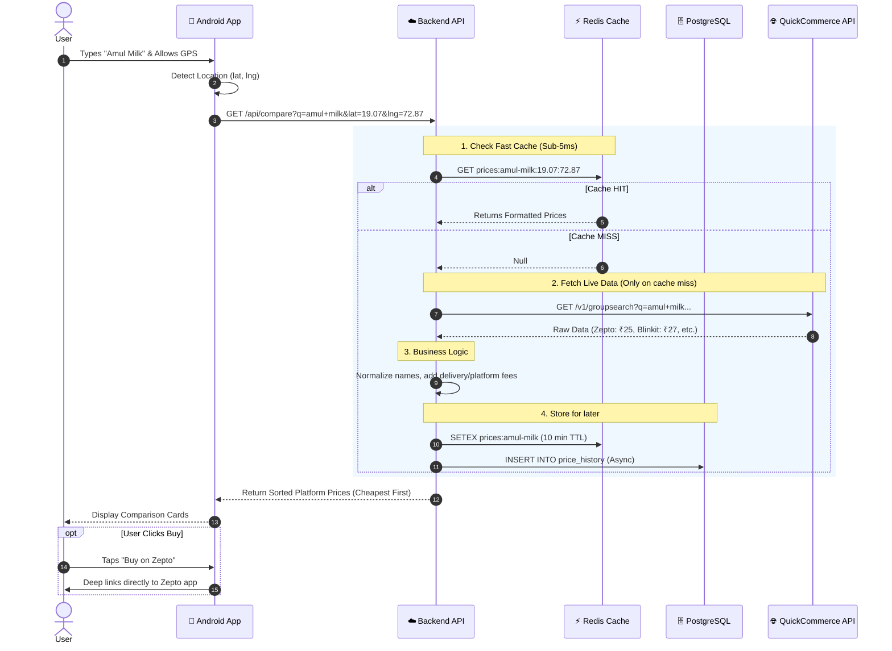
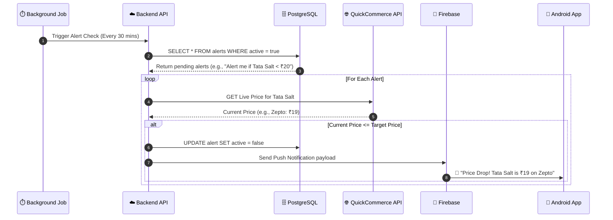

# 📊 GrocScan — Architecture Diagrams

These diagrams visualize exactly how data moves through the system and the step-by-step interactions between the user, the Android app, our backend, and the external APIs.

## 1. High-Level Data Flow Diagram (DFD)
This diagram shows the major components of the system and how data flows between them.

```mermaid
graph TD
    %% Entities
    U((👤 User))
    App[📱 Android App\nReact Native / Expo]
    API[☁️ GrocScan Backend\nNode.js on Cloud Run]
    Cache[(⚡ Redis Cache\n10-min TTL)]
    DB[(🗄️ PostgreSQL\nPrice History)]
    QCA[[🌐 QuickCommerce API\nExternal Provider]]
    FCM[[🔔 Firebase Cloud\nMessaging]]

    %% Flows
    U -->|Search Query,\nGPS / Pincode,\nBarcode Scan| App
    App -->|HTTP GET /api/compare| API
    
    API <-->|Read / Write\nFast Lookups| Cache
    API -->|Save Price Snapshots\nAlert Rules| DB
    
    API -->|Fetch Live Prices\n(If Cache Miss)| QCA
    QCA -->|Raw Prices\n(Blinkit, Zepto, etc.)| API
    
    API -->|Formatted & Sorted Prices| App
    App -->|Display Results & UI| U
    
    DB -.->|Trigger Price Drop| API
    API -.->|Send Push Notification| FCM
    FCM -.->|Alert Notification| App
```

---

## 2. Sequence Diagram: Product Search & Comparison
This diagram illustrates the step-by-step, chronological interaction for the core user journey: searching for a product and viewing the price comparison.



---

## 3. Sequence Diagram: Price Drop Alerts (Background Flow)
This shows how the system tracks prices in the background and notifies the user.


